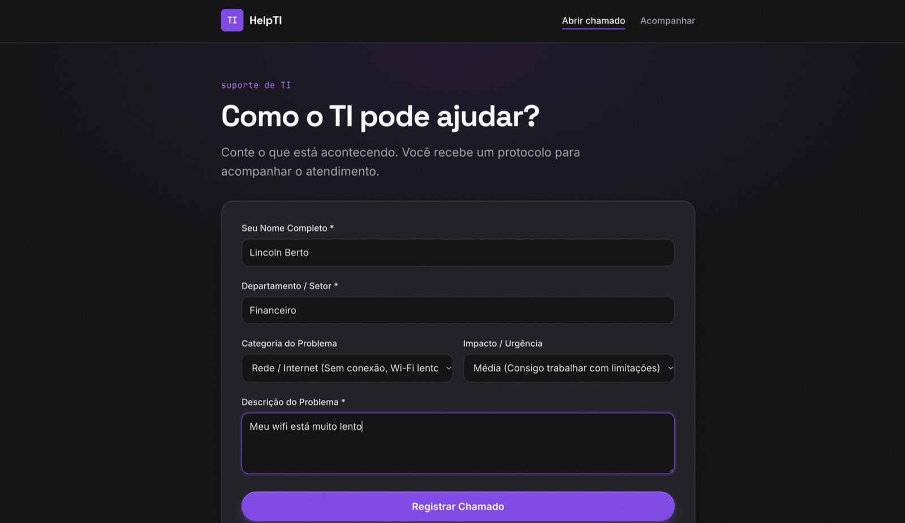
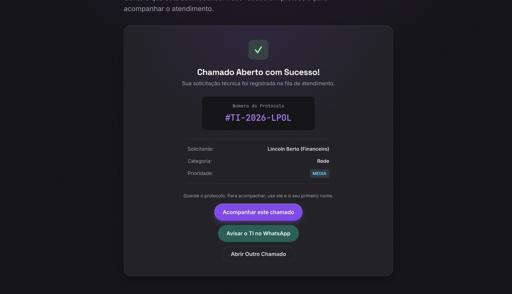
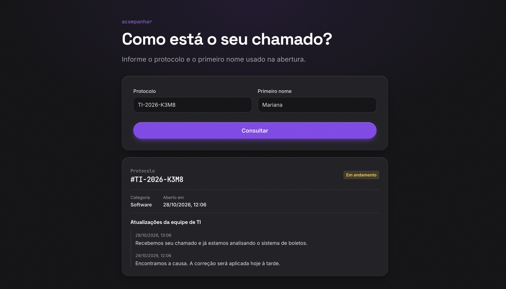
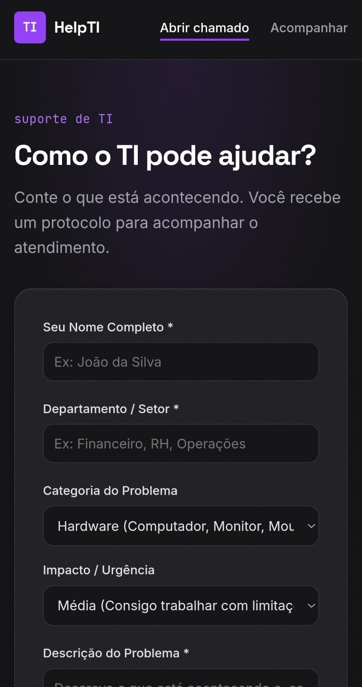
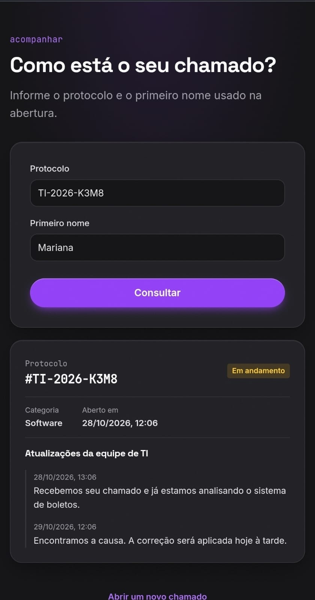
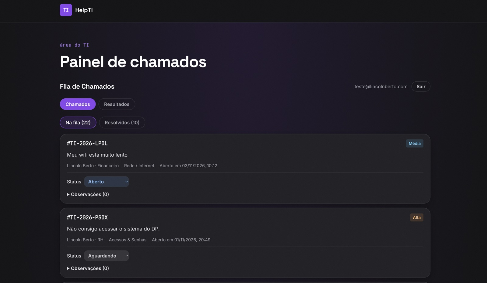
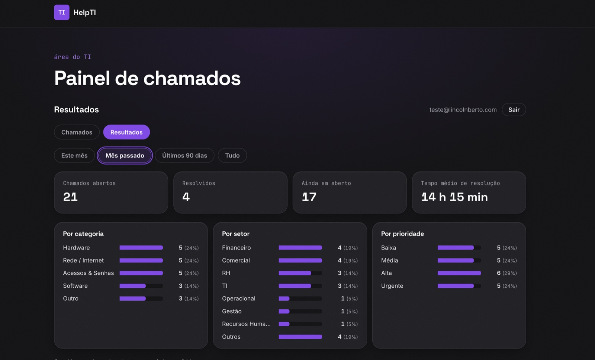
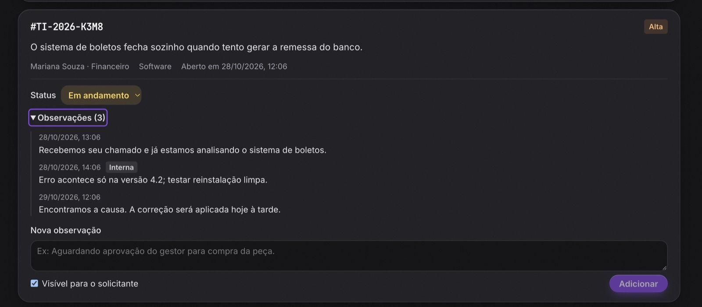

# 🎫 HELPTI — CENTRAL DE CHAMADOS DE TI

> [!NOTE]
> **Projeto real, feito para rodar no meu trabalho:** sistema de chamados de TI feito do zero com React, TypeScript e Supabase. Nasceu de uma dor real: sou o único profissional de TI da empresa e os pedidos chegavam por WhatsApp, no corredor e de boca, e muitos se perdiam. A segurança fica no banco (RLS), a consulta pública tem proteção contra força bruta e a privacidade (LGPD) foi tratada como requisito desde o início.

O colaborador abre um chamado **sem precisar de login**, recebe um protocolo e avisa o TI pelo WhatsApp com um clique. Depois, acompanha o andamento só com o protocolo e o primeiro nome. O técnico tem um painel fechado para atender a fila, mudar status e registrar notas públicas ou internas.

---

## 🌐 Demonstração

A instância em produção é interna e guarda dados reais dos colaboradores, por isso não é aberta ao público. Para mostrar o sistema funcionando, o vídeo e os prints usam apenas **dados fictícios**.

- **Vídeo no YouTube:** [https://youtu.be/eemmh7O4N1Y](https://youtu.be/eemmh7O4N1Y)

<div align="center">
  <a href="https://youtu.be/eemmh7O4N1Y">
    
  </a>
  <br>
  <sub>▶️ Clique na imagem para assistir à demonstração completa</sub>
</div>

### 🙋 Área do colaborador

<div align="center">
  <table>
    <tr>
      <td align="center" width="60%">
        <b>💻 Desktop</b><br><br>
        <br><br>
        <br><br>
        
      </td>
      <td align="center" width="40%">
        <b>📱 Mobile</b><br><br>
        <br><br>
        
      </td>
    </tr>
  </table>
</div>

### 🛠️ Área do técnico

<div align="center">
  <table>
    <tr>
      <td align="center" width="50%">
        <b>Fila de chamados</b><br><br>
        
      </td>
      <td align="center" width="50%">
        <b>Resultados (só números, sem dados pessoais)</b><br><br>
        
      </td>
    </tr>
    <tr>
      <td align="center" colspan="2">
        <b>Notas públicas e internas</b><br><br>
        <br>
        <sub>A nota marcada como <b>Interna</b> não aparece na consulta do colaborador (compare com a tela de consulta acima).</sub>
      </td>
    </tr>
  </table>
</div>

---

## 🚀 Stack Tecnológica e Decisões de Arquitetura

- **React 19 + TypeScript + Vite:** tipos literais estritos para categoria, prioridade e status (`src/types/ticket.ts`), então um valor inválido nem compila.
- **Supabase (Postgres):** banco, autenticação e funções SQL. O front usa só a chave pública (`anon`), e quem decide o que cada pessoa pode ver é o banco.
- **Row Level Security (RLS):** qualquer pessoa pode **criar** um chamado, mas ninguém de fora consegue **ler** a tabela. Só técnicos cadastrados na tabela `staff` leem e atualizam chamados.
- **Consulta pública por RPC:** em vez de liberar leitura na tabela, a função `get_ticket_status` recebe protocolo + primeiro nome e devolve só o necessário (status, categoria, datas e notas públicas).
- **Proteção contra força bruta:** testei atacando meu próprio sistema e a consulta aceitava cerca de 123 tentativas por segundo. Agora, depois de 5 erros em 15 minutos, aquele protocolo fica bloqueado. O limite é **por protocolo e não por IP**, porque dentro do banco o IP chega por cabeçalho e pode ser falsificado; o protocolo é justamente o que precisa ser protegido.
- **Trigger no banco:** a data de encerramento (`resolved_at`) é preenchida e limpa automaticamente quando o status muda, sem depender do front.
- **Migrations versionadas:** toda mudança no banco está em `supabase/migrations/`, em ordem, com comentários explicando o porquê.
- **Sem roteador:** são só quatro telas, então o endereço decide qual mostrar (`src/App.tsx`). O `vercel.json` manda todas as rotas para o `index.html`, e o F5 funciona em qualquer página.
- **Vercel:** hospedagem com SSL automático e publicação a cada `git push` na `main`.

---

## 📝 Funcionalidades em Destaque

### 🙋 Para o colaborador

- **Abertura sem login:** nome, setor, categoria, prioridade e descrição. Quanto menos barreira, mais gente usa.
- **Protocolo + confete:** cada chamado gera um protocolo no formato `#TI-2026-XXXX`.
- **Aviso pelo WhatsApp:** um botão monta a mensagem pronta com os dados do chamado. O link curto `wa.me` corrompia os emojis no redirecionamento, então o link usa `api.whatsapp.com/send` direto.
- **Acompanhamento (`/consulta`):** protocolo + primeiro nome mostram o status e as notas públicas do técnico.
- **Privacidade (`/privacidade`):** página explicando quais dados são coletados e para quê.

### 🛠️ Para o técnico (`/painel`)

- **Acesso restrito:** o cadastro público fica desligado no Supabase, e além do login a conta precisa estar na tabela `staff`.
- **Fila de chamados:** mudança de status (aberto, em andamento, aguardando e resolvido).
- **Notas públicas e internas:** a nota interna nunca chega ao colaborador, nem pela tela nem pela consulta.
- **Aba Resultados:** apenas números consolidados (total, abertos, resolvidos, tempo médio de resolução e distribuição por categoria, setor e prioridade), sem nenhum dado pessoal.

### 🎨 Interface

- **Visual do meu portfólio:** grafite com roxo, fontes self-hosted (Inter, Space Grotesk e JetBrains Mono) e tema escuro.
- **Acessibilidade:** HTML semântico, `aria-current` na navegação e rótulos nos campos.

---

## 🗂️ Estrutura

```
src/
  App.tsx                  escolhe a tela pelo endereço
  pages/                   abrir chamado, consulta, painel e privacidade
  components/              formulário, lista, notas, resultados e login
  lib/                     acesso ao Supabase, WhatsApp e cálculo das métricas
  hooks/useSession.ts      sessão do técnico logado
  types/  utils/  styles/  tipos, formatação, rótulos e CSS compartilhado
supabase/
  migrations/              estrutura do banco, RLS, trigger e RPC (aplicar em ordem)
  seed/demo.sql            chamados fictícios para demonstração
  seed/demo_remove.sql     remove só os chamados fictícios
public/fonts/              fontes locais em woff2
docs/readme/               prints usados neste README
vercel.json                rewrite de SPA
```

---

## 🛠️ Como Rodar

1. **Instalar:** `npm install`
2. **Variáveis de ambiente:** criar um `.env.local` na raiz (ele já está no `.gitignore`):
   ```
   VITE_SUPABASE_URL=https://seu-projeto.supabase.co
   VITE_SUPABASE_ANON_KEY=sua-chave-anon
   VITE_WHATSAPP_NUMBER=5511999999999
   ```
   Tudo que começa com `VITE_` vai para o JavaScript público do site. Por isso aqui entra só a chave `anon`, **nunca** a `service_role`.
3. **Banco:** rodar os arquivos de `supabase/migrations/` em ordem no SQL Editor do Supabase.
4. **Técnico:** criar o usuário em *Authentication → Users*, desligar o cadastro público e inserir o `id` dele na tabela `public.staff`.
5. **Rodar:** `npm run dev` e abrir http://localhost:5173

---

## 👨‍💻 Autor

Desenvolvido por **Lincoln Berto**.

- **LinkedIn:** [https://www.linkedin.com/in/lincoln-berto/](https://www.linkedin.com/in/lincoln-berto/)
- **GitHub:** [https://github.com/eilincoln](https://github.com/eilincoln)
- **Portfólio:** [https://www.lincolnberto.com](https://www.lincolnberto.com)
